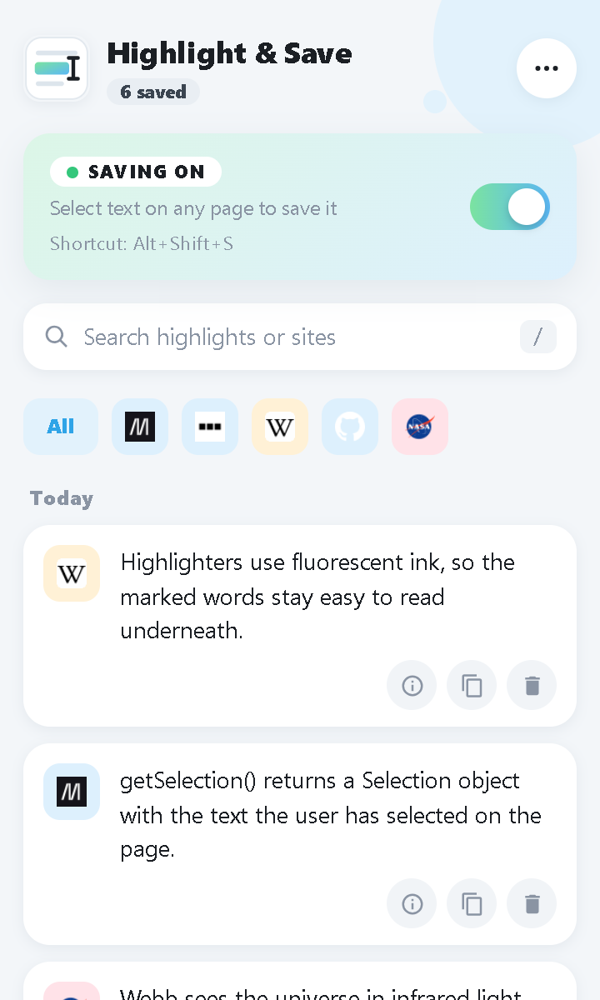

# Highlight & Save

A Chrome extension that saves the text you select. Turn saving on, read as usual, and every selection is kept with the page it came from, ready to search, copy or export later.

**Website and download:** https://omarbassaj.github.io/highlight-and-save/



## Features

- **One switch:** turn saving on while you read and off when you're done. Saving always starts off when Chrome opens.
- **Keyboard shortcut:** <kbd>Alt</kbd>+<kbd>Shift</kbd>+<kbd>S</kbd> switches saving on and off. You can change it at `chrome://extensions/shortcuts`.
- **Toolbar badge:** shows how many highlights you have while saving is on.
- **Source and time:** each highlight keeps the page title, a link back to the page, and when it was saved.
- **Filter by site:** click a site's icon to see only what you saved there.
- **Search and date groups:** Today, Yesterday, This week, then by month.
- **Copy, copy all, export:** export writes just the text to a `.txt` file.
- **Undo:** after deleting, clearing or removing duplicates.
- **Light and dark mode**, following Chrome or your system.

## Install

The extension isn't in the Chrome Web Store yet, so it's added as an unpacked extension:

1. Download [`highlight-and-save-1.6.zip`](website/highlight-and-save-1.6.zip) and unzip it.
2. Open `chrome://extensions`.
3. Turn on **Developer mode** (top right).
4. Click **Load unpacked** and choose the `highlight-and-save` folder.

It also works in other Chromium browsers, such as Edge and Brave.

## Privacy

Highlights are stored only in your browser (`chrome.storage.local`). There's no account and no server, and nothing is sent anywhere. Nothing is saved while the switch is off.

| Permission | Why |
| --- | --- |
| `storage` | Keeps your highlights and the on/off setting. |
| All websites | Notices text you select on any page while saving is on. |
| `scripting` | Starts working in tabs that were already open when it was installed. |
| `favicon` | Shows each site's icon next to your highlights. |

## Project layout

```
HighlightAndSave/        The extension (load this folder for development)
  manifest.json
  background.js          Saves highlights, badge, shortcut, start-up switch-off
  content.js             Runs on pages; sends selected text while saving is on
  popup.html/.js         The popup
  styles.css
  icons/                 icon.svg and icon16.svg are the sources for the PNGs
website/                 Landing page, published with GitHub Pages
  index.html
  highlight-and-save-1.6.zip
  images/
```

## Development

Load the `HighlightAndSave` folder with **Load unpacked**, then click the reload arrow on the extension after each change. Open tabs pick up a new version of `content.js` when they're refreshed.

When releasing a new version, update `version` in `manifest.json`, rebuild the zip in `website/` so it contains a single `highlight-and-save` folder, and update the version and file name on the landing page.

## License

MIT, see [LICENSE](LICENSE).
